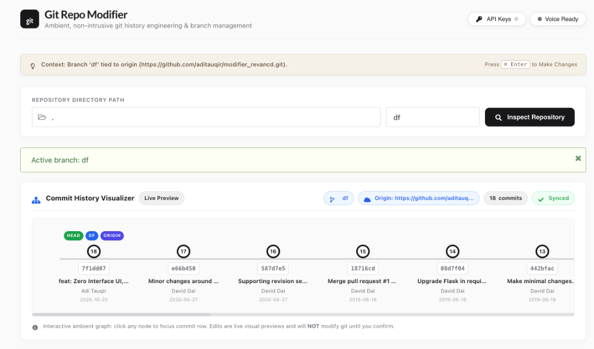

# Git Repo Modifier

> **A minimalist, ambient Git history sculptor and interactive visualizer.**
> Rewrite commit messages, author identities, timestamps, manage remote origins, switch/create branches, delete commits with zero data loss, and sculpt atomic commits using AI models via OpenRouter, DeepSeek, or OpenAI.



---

## ✨ Features

- **Zero Interface Minimal Design**: Clean, modern, distraction-free aesthetic with an airy palette (`#FAFAFA` / `#F0F0F0`), zero artificial box-shadows, and progressive disclosure panels.
- **Dynamic Real-Time Visualizer**: Interactive canvas showing all repository branches simultaneously, branch heads, active branch indicator, origin remote sync badge, and live modified commit tags.
- **Editable Commit Attributes**:
  - Full commit message editing
  - Author name and author email modification
  - Commit date and time (preserves commit chronology)
  - Cryptographic commit SHA displayed read-only
- **Commit Deletion (Zero Data Loss)**:
  - Delete any unwanted commit by safely merging/latching its diff into either the **Previous (older)** commit or **Next (newer)** commit.
  - Guarantees zero file loss and zero change loss using low-level tree reconstruction (`git commit-tree`).
- **Multi-Branch Management**:
  - Live dropdown to view and switch between all repository branches.
  - Create new Git branches directly from the interface.
- **Remote Origin Configuration**:
  - Inspect connected origin remote URL.
  - Retarget origin to a new repository URL.
  - Option to automatically force-push rewritten branches upon confirmation.
- **Staged Review & Auto-Stashing**:
  - Review all pending modifications in a confirmation modal before anything is executed.
  - Automatically stashes uncommitted/dirty working directory changes prior to rewrite to prevent `Cannot rewrite branches: You have unstaged changes` errors.
- **Persistent State**:
  - Repository file path and active branch are saved in `localStorage` and URL parameters (`?addr=...&rev=...`).
  - Refreshing or closing the browser preserves your working repository path.
- **AI History Engineer (Diff Sculptor)**:
  - Synthesize conventional, atomic commits from complex diffs or instructions.
  - Native support for **OpenRouter** (type any model ID as documented on OpenRouter, e.g. `anthropic/claude-3.5-sonnet`, `deepseek/deepseek-r1`, `openai/gpt-4o`).
  - Support for DeepSeek (`api.deepseek.com`), OpenAI (`api.openai.com`), Groq, Google Gemini, and custom OpenAI-compatible endpoints.
  - Dedicated popout modal in the top navigation to store and manage API keys locally in browser storage.
- **Smart `/rewrite` CLI & Zsh Integration**:
  - Run `/rewrite` from any folder in your terminal.
  - Automatically checks if your current working directory is inside a Git repository. If yes, it auto-detects the repository root and active branch and launches the visualizer. If not, it falls back to the default repository.
- **In-Browser Exit & Server Shutdown**:
  - One-click Exit button in the top navigation header.
  - Confirms and safely shuts down the background Python server process, cleanly releasing port 5000 and displaying a session termination screen.

---

## 🚀 Quick Start

### 1. Prerequisites
- Python 3.8+
- Git 2.20+
- Node.js & npm (optional, only needed if rebuilding frontend JSX)

### 2. Installation

Clone your repository and install dependencies:

```bash
git clone https://github.com/aditauqir/modifier_revancd.git
cd modifier_revancd

# Create and activate a Python virtual environment
python3 -m venv .venv
source .venv/bin/activate

# Install required Python packages
pip install Flask GitPython requests
```

### 3. Launching the App

Start the background service and open the browser:

```bash
./rewrite
```

Or run directly with Python:

```bash
python main.py
```

Then visit `http://127.0.0.1:5000` in your web browser.

---

## ⚡ Terminal Integration (`/rewrite` command)

You can launch the visualizer directly from any Git repository on your machine by adding an alias to your shell configuration (`~/.zshrc` or `~/.bashrc`).

### Add alias to `~/.zshrc`:

```zsh
echo 'alias /rewrite="/Users/aditauqir/Code/git_modifier/rewrite"' >> ~/.zshrc
source ~/.zshrc
```

*(Replace `/Users/aditauqir/Code/git_modifier` with the path where you cloned this repository).*

### How it works:

```zsh
# Navigate to any git project on your system
cd ~/Work/my-awesome-app

# Launch /rewrite
/rewrite
```

The script will:
1. Verify if `my-awesome-app` is a Git repository (`git rev-parse --is-inside-work-tree`).
2. Detect the repository root and current branch (e.g. `feature/login`).
3. Ensure the local Flask server is running.
4. Launch your browser with `http://127.0.0.1:5000/?addr=...&rev=feature/login` pre-loaded.

If invoked from a non-git directory, it safely falls back to the default repository.

---

## 🛠️ Usage Guide

### Modifying Commits
1. Open the repository in the browser.
2. Edit any commit message, author name, email, date, or time in the commit table.
3. Observe real-time changes reflected in the dynamic visualizer.
4. Click **Make Changes** in the header or press `Cmd+Enter` (`Ctrl+Enter`).
5. Review the diff summary in the confirmation modal and click **Confirm & Apply Changes**.

### Deleting Commits (Without Losing Files)
1. Click the trash icon (`🗑️`) next to the commit you wish to remove.
2. Choose where to merge the commit's diff:
   - **Latch to Previous (Older)**: Merges the changes into the parent commit (squash).
   - **Latch to Next (Newer)**: Bypasses the commit so child commits absorb the file modifications.
3. Confirm deletion. The repository history is rewritten while all working tree files remain intact.

### Using the AI Git Engineer
1. Click the **API Keys** button in the top navigation to add your OpenRouter, DeepSeek, or OpenAI API key.
2. Click **AI Engineer** on the commits table.
3. Select your provider and model (e.g. `anthropic/claude-3.5-sonnet` or any model name from OpenRouter docs).
4. Enter diffs or instructions and click **Synthesize Commits**.
5. Click **Apply All Commits** to load them directly into your commit modification pipeline.

---

## 🏗️ Development & Building

The frontend is built with React and bundled using `esbuild`.

To rebuild the frontend assets:

```bash
# Development build
npx esbuild static/src/main.jsx --jsx-factory=React.createElement --jsx-fragment=React.Fragment --outfile=static/build/main.js

# Production minified build
npx esbuild static/src/main.jsx --jsx-factory=React.createElement --jsx-fragment=React.Fragment --outfile=static/build/main.min.js --minify
```

---

## 📄 License

[ISC](https://opensource.org/licenses/ISC)
